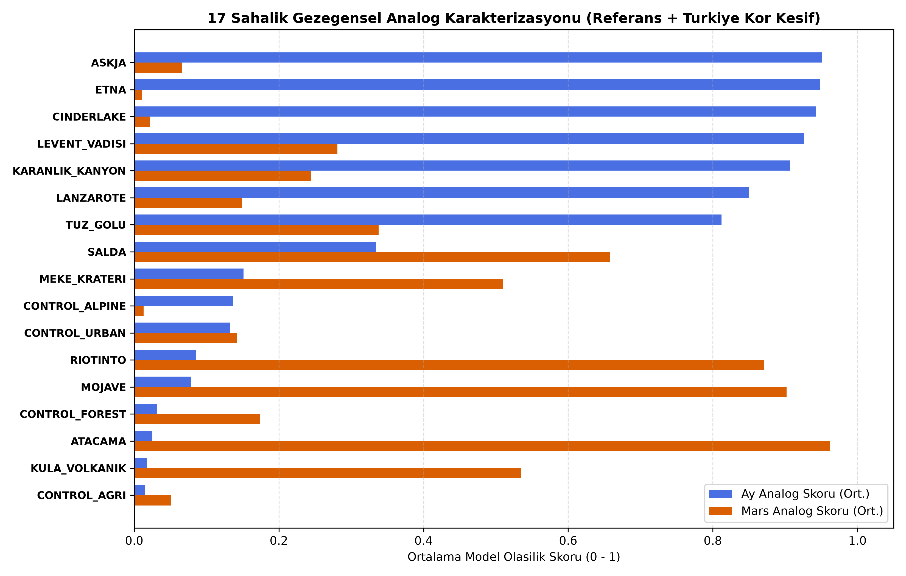
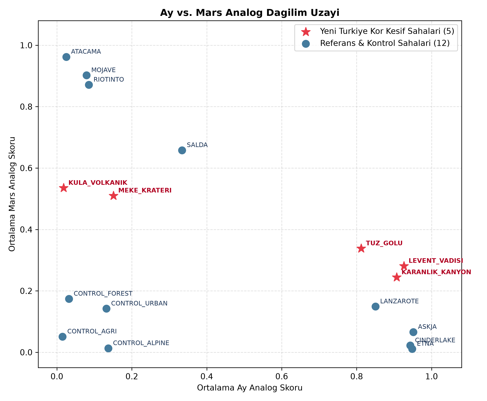
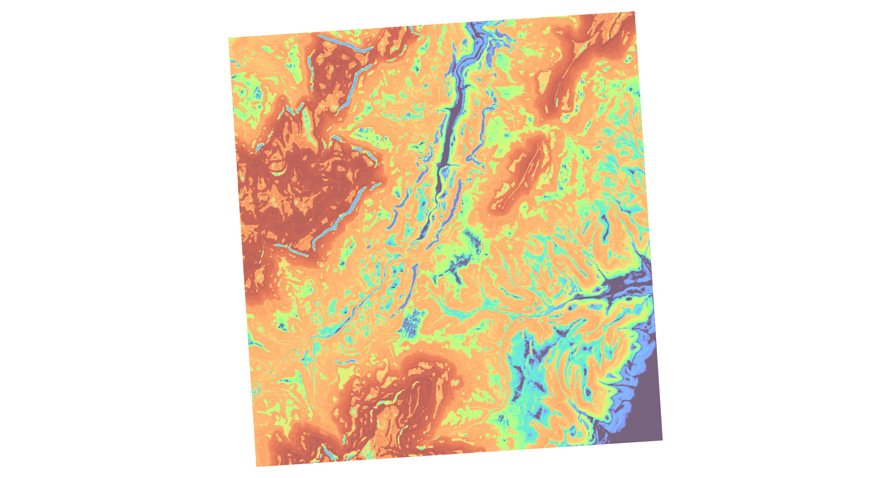
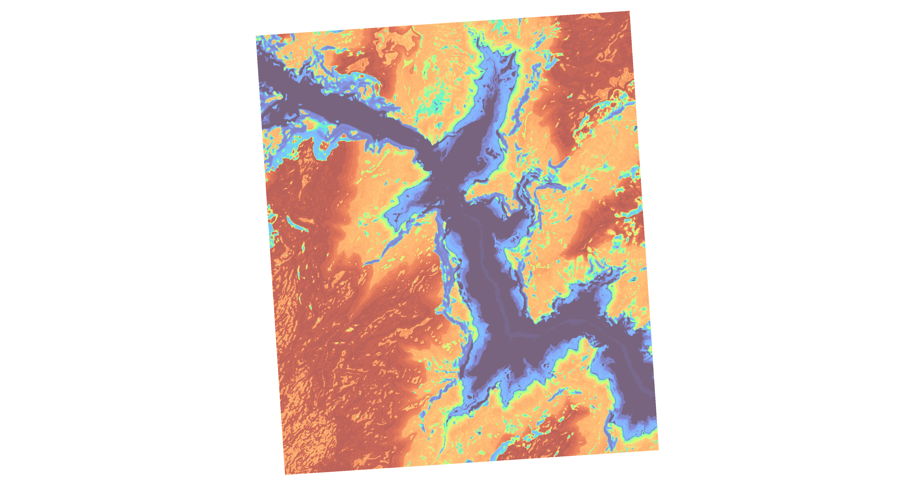

# PlanetaryAnalogAI: Blind Discovery of Lunar & Martian Analog Sites on Earth

**PlanetaryAnalogAI** is an end-to-end multispectral remote sensing and machine learning pipeline designed to automatically identify and characterize high-priority **Lunar** and **Martian** planetary analog sites on Earth without prior labeling (*"Blind Discovery"*).

## Methodology & Pipeline Architecture
To prevent overfitting and validate true geological generalization, the model was trained exclusively on **12 global reference & negative control sites** and evaluated blindly on **5 unseen candidate sites in Türkiye**:

- **`01_global_catalog.py` & `01b_download_sites.py`**: Automated acquisition and preprocessing of multispectral satellite imagery across 17 sites (8 global analogs, 4 negative controls, 5 blind discovery targets).
- **`02_features.py`**: Extraction of spectral indices, iron-oxide proxies, vegetation absence masks, and geomorphological texture features.
- **`03_train.py` & `04_predict.py`**: Pixel-level probabilistic classification outputting dual-band GeoTIFF rasters (`Band 1: Lunar Analog Probability`, `Band 2: Martian Analog Probability`).

## Quantitative Results (`analog_characterization_report.csv`)

| Site Name | Category | Lunar Mean | Lunar Max | Martian Mean | Martian Max | Primary Analog Character |
| :--- | :--- | :---: | :---: | :---: | :---: | :--- |
| **Levent Vadisi (TR)** | Blind Discovery | **0.926** | **0.993** | 0.281 | 0.780 | High-Priority Lunar Analog |
| **Karanlık Kanyon (TR)** | Blind Discovery | **0.907** | **0.993** | 0.244 | 0.655 | High-Priority Lunar Analog |
| **Tuz Gölü (TR)** | Blind Discovery | **0.812** | **0.948** | **0.338** | **0.954** | Dual Lunar-Martian Evaporite |
| **Kula Volkanik (TR)** | Blind Discovery | 0.018 | 0.920 | **0.535** | **0.994** | High-Priority Martian Basaltic |
| **Meke Krateri (TR)** | Blind Discovery | 0.151 | 0.970 | **0.510** | **0.999** | Martian Volcanic Maar |
| **Control Sites (Agri/Forest/Urban/Alpine)** | Negative Control | 0.015–0.137 | — | 0.013–0.174 | — | Successfully Filtered Out |

### Statistical Comparison & Phase Space Distribution

## Spatial & Geological Validation (QGIS)
Pixel-level probability maps were validated in **QGIS** against high-resolution satellite basemaps:
- **Levent Vadisi (Lunar Analog):** High probability scores precisely isolate steep canyon walls and exposed rocky escarpments.
- **Karanlık Kanyon (Lunar Analog):** Consistent high-confidence lunar regolith-like spectral signatures along gorge formations.

| Levent Vadisi (Lunar Probability) | Karanlık Kanyon (Lunar Probability) |
| :---: | :---: |
|  |  |
